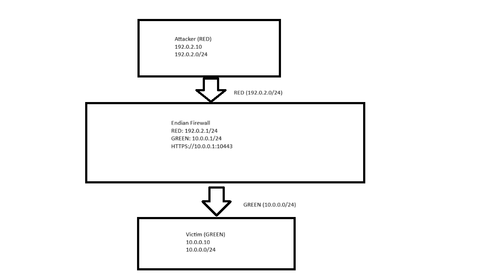
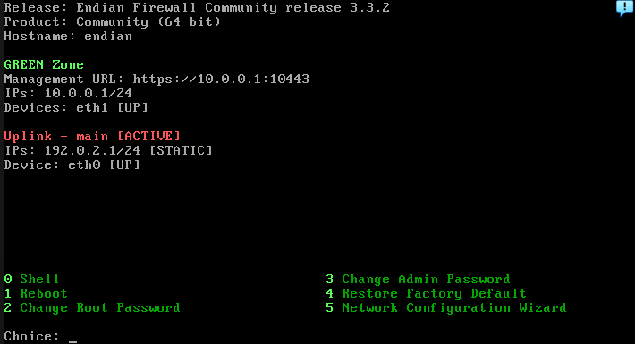
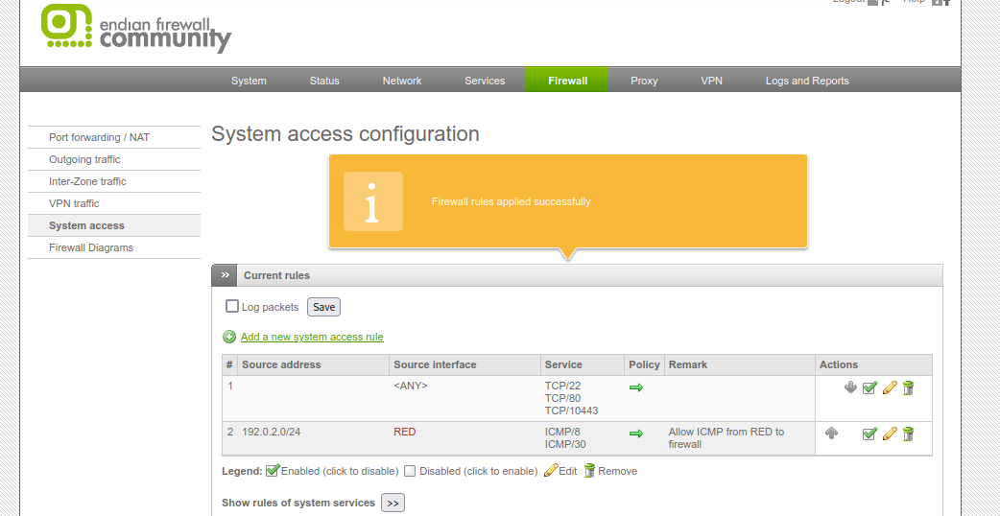
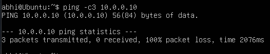
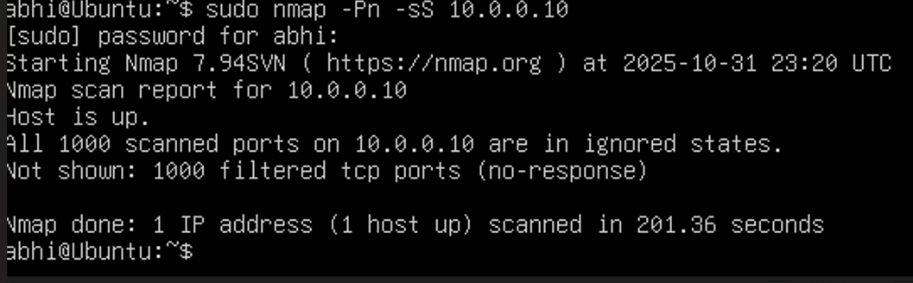
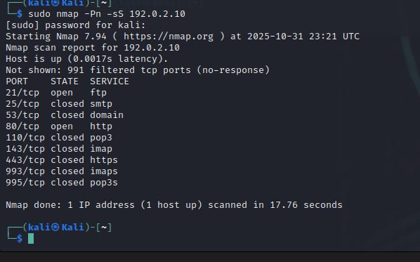
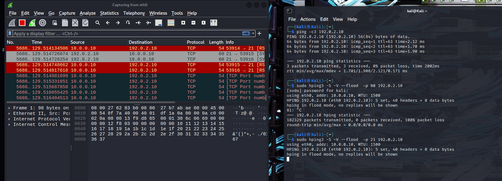
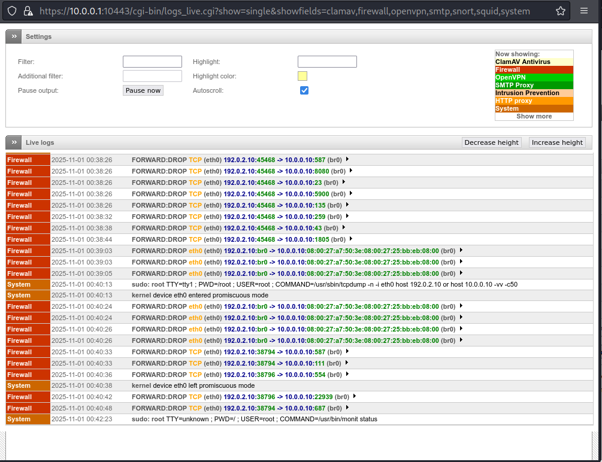

# Endian Firewall lab

I set up Endian Firewall Community 3.3.2 between an attacker network and a protected LAN in VirtualBox, then attacked through it to check the rules held. This was my part of a group assignment for the Network Security module (CYSC H1001) at TU Dublin, October 2025. Each of the three of us built and tested a different open-source firewall (IPFire, nftables and Endian). The Endian build, tests and write-up were mine.

The aim was to block every connection started from the untrusted RED network into the GREEN LAN, still let GREEN hosts connect out, and log the dropped traffic as evidence. All three worked: an Nmap SYN scan from RED found all 1,000 ports on the victim filtered, and Endian's live log recorded each dropped packet.

## Lab setup

| Machine | Zone | Address |
| --- | --- | --- |
| Endian Firewall 3.3.2 | RED uplink (eth0) | 192.0.2.1/24 |
| Endian Firewall 3.3.2 | GREEN LAN (eth1) | 10.0.0.1/24 |
| Attacker (Ubuntu) | RED, untrusted | 192.0.2.10 |
| Victim (Kali) | GREEN, protected | 10.0.0.10 |



Before adding the firewall I pinged between the two VMs on a VirtualBox NAT network to confirm they could reach each other. Any blocking afterwards would then be down to Endian.



## Rules I configured

| Rule | Where in Endian | Purpose |
| --- | --- | --- |
| Allow ICMP 8 and 30 from 192.0.2.0/24 to the firewall | Firewall > System access | Lets RED hosts ping the firewall itself for diagnostics |
| Deny RED to GREEN, placed first | Firewall > Inter-Zone traffic | Blocks any connection started from the attacker network |
| Allow GREEN to RED | Firewall > Inter-Zone traffic | Lets internal hosts make outbound web and DNS connections |
| Logging on deny rules | Inter-Zone traffic | Records blocked attempts in the live log |

Rule order matters because Endian checks rules top to bottom. The deny rule goes first so nothing further down can let RED traffic into GREEN by mistake.



## Tests and results

| Test | From | Commands | Result |
| --- | --- | --- | --- |
| 1. Inbound blocked | Attacker (RED) | `ping -c3 10.0.0.10`, `nmap -Pn -sS 10.0.0.10` | 100% packet loss; all 1,000 ports filtered |
| 2. Outbound allowed | Victim (GREEN) | `ping -c3 192.0.2.10`, `nmap -Pn -sS 192.0.2.10`, `curl -I http://192.0.2.10` | Pings replied; FTP (21) and HTTP (80) open on the attacker |
| 3. Stateful behaviour | Both | Held a connection open from GREEN while scanning from RED | Existing session stayed up; new RED connections still dropped |
| 4. SYN flood | Victim (GREEN) | `hping3 -S --flood -p 80` and `-p 21` at the attacker | Over 182,000 SYN packets sent, captured in Wireshark |

### Test 1: the attacker can't get in

Ping from the attacker to the victim lost every packet. An Nmap SYN scan marked the host as up because of `-Pn`, but every one of the 1,000 ports came back filtered, which means the firewall dropped the probes without replying.





### Test 2: the victim can still get out

The same scan in the other direction got through. It found FTP and HTTP open on the attacker machine, so outbound traffic was passing as intended.



### Test 4: SYN flood

From the GREEN side I flooded the attacker's ports 80 and 21 with `hping3` while capturing on Wireshark, to see how the traffic looked passing through the firewall.



### Evidence in the live log

Endian's live log (Logs and Reports > Live Log) shows a `FORWARD:DROP` line for each blocked packet from 192.0.2.10 to 10.0.0.10, with the timestamp, protocol, ports and interfaces (eth0 in, br0 out). The destination ports jump around (587, 8080, 23, 5900, 135...) because that's Nmap's scan working through its port list. You can also see my `tcpdump` session on the firewall shell logged as a system event.



## What I learned

- A default-deny inbound policy with outbound allowed is easy to set up in Endian's zone model, but rule order decides whether it actually works.
- Filtered and closed aren't the same. Filtered ports (no reply at all) give an attacker far less information than closed ones that send back a reset.
- Testing connectivity before turning the firewall on is what makes the results trustworthy. Otherwise a failed ping might just be a broken lab network.

## Limitations

The lab was isolated, so internet access and DNS would need extra NAT setup in the hypervisor. I tested with a small set of tools (ping, Nmap, curl, hping3) rather than a full attack, and I didn't measure the firewall's CPU load during the flood.

## Commands used

```bash
# Attacker (Ubuntu, RED)
ip a; ip route
ping -c3 10.0.0.10
sudo nmap -Pn -sS 10.0.0.10

# Victim (Kali, GREEN)
ping -c3 192.0.2.10
sudo nmap -Pn -sS 192.0.2.10
curl -I http://192.0.2.10
sudo hping3 -S -V --flood -p 80 192.0.2.10

# Endian shell
sudo tcpdump -n -i eth0 host 192.0.2.10 or host 10.0.0.10 -vv -c50
sudo iptables -L FORWARD -n -v --line-numbers
```

## Tools

Endian Firewall Community 3.3.2, VirtualBox, Ubuntu, Kali Linux, Nmap, hping3, Wireshark, tcpdump, iptables
